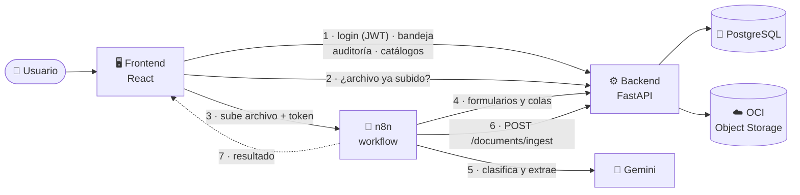
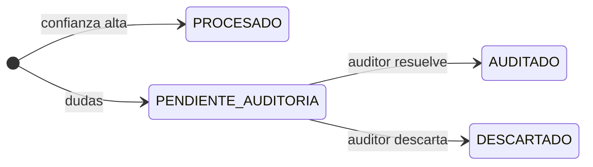

# MediFlow — Agente Autónomo para Triaje, Extracción y Enrutamiento de Documentos Clínicos

> **Hackathon ONE G10** | *Oracle Next Education & Alura*
> **Sector:** HealthTech / Gestión Hospitalaria / Aseguradoras de Salud

Este README explica **cómo funciona el sistema completo** y cómo levantarlo. El detalle de cada pieza está en su propio README:

| Pieza | Qué es | Documentación |
|---|---|---|
| 🖥️ **Frontend** | Aplicación web (React + Vite) | [`frontend/README.md`](frontend/README.md) — pantallas, estructura, variables y endpoints que usa cada pantalla |
| ⚙️ **Backend** | API REST (FastAPI) | [`backend/README.md`](backend/README.md) — instalación, variables, endpoints, reglas de negocio, base de datos y pruebas |
| 🤖 **Workflow n8n** | Orquestación de la IA (Gemini) | [`workflow/README.md`](workflow/README.md) — flujo, configuración, edición y uso de tokens |

**Índice:** [Qué es](#-qué-es-mediflow) · [Cómo funciona](#-cómo-funciona) · [Roles](#-roles-de-usuario) · [Puesta en marcha](#-puesta-en-marcha) · [Estructura](#-estructura-del-repositorio) · [Documentación](#-más-documentación) · [Tecnologías](#️-tecnologías)

---

## 📋 ¿Qué es MediFlow?

Hospitales y aseguradoras reciben cada día cientos de documentos clínicos (laboratorios, recetas, epicrisis, informes de imágenes, licencias...) que hoy se leen y derivan **a mano**. Es lento y propenso a errores.

**MediFlow** automatiza ese trabajo con Inteligencia Artificial:

1. **Recibe** el documento (PDF o imagen).
2. **Lo clasifica y extrae** los datos clave: paciente (identificación de cualquier país y N° de ficha), profesionales, diagnósticos con CIE-10, prioridad y el detalle propio del tipo (parámetros de laboratorio, medicamentos, hallazgos...).
3. **Calcula su confianza** y **decide a qué cola enviarlo** (Urgencias, Farmacia, Oncología, Ficha Clínica...).
4. Si la confianza es baja o algo no calza, lo deja en una **bandeja de auditoría** para que una persona lo revise y corrija (*Human-in-the-Loop*).
5. **Guarda** los archivos originales y el resultado en **Oracle Cloud (OCI Object Storage)** y lo registra en **PostgreSQL**.

### Funcionalidades

| Módulo | Qué hace |
|---|---|
| **Ingesta con IA** | n8n envía el archivo a Gemini (modelo rápido y, si hay dudas, uno más preciso); el backend normaliza, valida y calcula el score. |
| **Detección de duplicados** | Avisa **antes** de procesar si el mismo archivo ya se subió (huella SHA-256) y, al ingerir, marca como *posible duplicado* uno con el mismo paciente, tipo y fecha que otro. |
| **Inicio y detalle** | KPIs por prioridad, carga rápida y bandeja. Cualquier documento abre su **detalle**: el original junto a los datos extraídos, duplicados e historial. |
| **Consola de Triaje** | Casos activos de las colas asistenciales, por severidad: marcar como atendido o **derivar** a otra cola con motivo. |
| **Expedientes** | Repositorio en vista kanban o lista, con filtros. |
| **Auditoría (Human-in-the-Loop)** | Tomar el caso, corregir con un formulario que cambia según el tipo de documento, resolver o descartar. |
| **Corrección posterior** | Corregir un documento ya procesado o auditado. Cada cambio queda en un **historial** (quién, cuándo, por qué y qué valor cambió). |
| **Usuarios y catálogos** | Usuarios con su área y sus colas, y mantenedores de tipos de documento, áreas y colas, con historial y *Smart Delete*. |
| **Seguridad y trazabilidad** | JWT con refresh token rotativo, roles, bloqueo de login tras 5 intentos y un ID de seguimiento que une los logs del navegador, n8n y el backend. |

---

## 🧩 Cómo funciona

### Las piezas y cómo se comunican



| Pieza | Responsabilidad | No hace |
|---|---|---|
| **Frontend** | Interfaz de cada rol; calcula la huella del archivo y lo envía a n8n con el token del usuario | No llama a la IA ni decide nada del triaje |
| **n8n** | Arma el prompt con los catálogos vigentes, llama a Gemini y entrega el resultado al backend | No decide el estado final ni guarda datos |
| **Backend** | Fuente de verdad: valida, normaliza, calcula el score, aplica el triaje, guarda en OCI y PostgreSQL, y controla los permisos | No llama a la IA |

### El recorrido de un documento

1. El usuario inicia sesión y obtiene un JWT del backend.
2. Al elegir un archivo, el front calcula su huella y pregunta si ya existe: si es así, avisa **antes** de gastar en la IA.
3. El front sube el documento al **webhook de n8n** junto con su token.
4. n8n lee del backend los **tipos de documento con sus campos** y las **colas activas**.
5. Gemini clasifica y extrae los datos eligiendo **solo** entre las opciones del catálogo. Si el modelo rápido tiene dudas, n8n repite con el preciso.
6. n8n envía el resultado a `POST /documents/ingest`. El backend normaliza (identificación, CIE-10), calcula el score, busca duplicados, aplica el triaje, guarda en **OCI** y registra en **PostgreSQL**.
7. n8n devuelve al front la respuesta del backend: tipo, prioridad, destino y estado.

### Ciclo de vida y regla de triaje



Un documento queda en `PENDIENTE_AUDITORIA` si se cumple **cualquiera** de estas condiciones (si no, queda `PROCESADO`):

- score de confianza **menor a 0.85** (lo calcula el backend con la autoevaluación de la IA y sus propias validaciones);
- el workflow pide auditoría humana, o el tipo es `OTRO` (no clasificable);
- el tipo o la cola no existen o están inactivos en el catálogo;
- el detalle no corresponde al tipo, o los campos propios del tipo no cumplen su esquema;
- es **posible duplicado** de otro documento.

| Estado | Significado |
|---|---|
| `PROCESADO` | Enrutado automáticamente a su cola |
| `PENDIENTE_AUDITORIA` | Espera revisión humana |
| `AUDITADO` | Resuelto por un auditor |
| `DESCARTADO` | Descartado por un auditor (no clínico, duplicado, ilegible) |
| `ELIMINADO` | Eliminación lógica por un ADMIN desde cualquier estado: se conserva y se puede restaurar al estado que tenía |

Un documento `PROCESADO` o `AUDITADO` que se corrige o deriva después **conserva su estado**: cambia su contenido o su cola y queda en el historial. Score, motivos, duplicados y rutas en OCI: [`backend/README.md`](backend/README.md#documentos).

### Catálogos: el sistema se configura sin tocar código

Los **tipos de documento**, las **colas de enrutamiento** y las **áreas** son tablas maestras que se administran desde la aplicación. n8n lee los tipos y colas **antes de cada documento**, así que agregar, editar o desactivar uno cambia de inmediato lo que la IA puede elegir. Un tipo nuevo puede definir sus propios campos (JSON Schema): la IA los extrae y el formulario de auditoría los muestra. Detalle: [`backend/README.md`](backend/README.md#tablas-maestras-catálogos).

---

## 👥 Roles de usuario

| Rol | Menú | Puede hacer |
|---|---|---|
| `ADMIN` | Inicio · Triaje · Expedientes · Auditoría · Usuarios · Catálogos | Todo, incluido eliminar y restaurar documentos |
| `AUDITOR_CLINICO` | Inicio · Triaje · Expedientes · Auditoría | Subir y ver todos los documentos, auditar, **corregir**, atender y derivar casos de sus colas |
| `OPERADOR` | Inicio · Triaje · Documentos | Subir documentos y ver **solo los que subió, los derivados a sus colas asignadas y los de Ficha Clínica** |
| `GESTOR_USUARIOS` | Usuarios · Catálogos (solo Áreas) | Gestionar usuarios y áreas; sin acceso a documentos |

Todos pueden ver su perfil, cambiar su contraseña y **consultar** los catálogos. Permisos por endpoint: [`backend/README.md`](backend/README.md#endpoints).

---

## 🚀 Puesta en marcha

### Requisitos

| Herramienta | Para qué | Cómo comprobarlo |
|---|---|---|
| [Docker Desktop](https://www.docker.com/products/docker-desktop/) (o Docker Engine + Compose) | PostgreSQL y n8n | `docker compose version` |
| Python **3.11 o superior** | Backend | `py -0p` (Windows) o `python3 --version` |
| Node.js **20 o superior** | Frontend | `node --version` |
| Llave de API de **Google Gemini** | Que n8n clasifique documentos | [aistudio.google.com](https://aistudio.google.com/) |
| Credenciales de OCI *(opcional al inicio)* | Guardar documentos en Oracle Cloud | [`backend/README.md`](backend/README.md#4-configurar-oci-opcional-para-empezar) |

> Sin OCI la API **arranca igual**: funcionan el login, los usuarios y los catálogos. Fallan la ingesta y la vista de documentos, y `/health` responde `503`.

Los comandos se ejecutan desde la **raíz del repositorio**. Cada paso enlaza a su README si necesitas más detalle o algo falla.

**1. Base de datos y n8n (Docker)**

```bash
cp .env.example .env            # Windows PowerShell: Copy-Item .env.example .env
docker compose up -d
docker compose ps               # postgres debe quedar "healthy"
```

La primera vez, Docker crea las tablas y carga las áreas, los tipos de documento, las colas y un usuario de prueba por rol. Si tu base ya existía, ver [Actualizar una base existente](backend/README.md#actualizar-una-base-existente).

> Hay **dos archivos `.env`** en desarrollo: el de la **raíz** (usuario, contraseña y base que crea Docker) y `backend/.env` (configuración de la API). El usuario, la contraseña y el nombre de la base deben ser **iguales en ambos**.

**2. Backend** → [detalle](backend/README.md#instalación-local)

```bash
cd backend
python -m venv .venv            # Windows: py -3.12 -m venv .venv
source .venv/bin/activate       # Windows PowerShell: .venv\Scripts\Activate.ps1
pip install -r requirements-dev.txt
cp .env.example .env            # Windows PowerShell: Copy-Item .env.example .env
uvicorn app.main:app --reload --port 8000     # Swagger: http://localhost:8000/docs
```

**3. Workflow de n8n** → [detalle](workflow/README.md#cómo-importar)

1. Abrir <http://localhost:5678> y crear el usuario owner.
2. **Import from file** → `workflow/MediFlow_unificado.json`.
3. Crear una credencial **Google Gemini(PaLM) Api** con tu llave y asignarla en los nodos **Gemini rápido** y **Gemini preciso**.
4. Activar el workflow.

**4. Frontend** → [detalle](frontend/README.md#puesta-en-marcha)

```bash
cd frontend
cp .env.example .env            # Windows PowerShell: Copy-Item .env.example .env
npm install
npm run dev                     # http://localhost:5173
```

**5. Probar.** Inicia sesión con un usuario de prueba y sube un PDF desde **Inicio** o **Procesar Documento IA**: verás un resumen con tipo, prioridad, destino y estado.

### Usuarios de prueba

Los crea `docker/postgres/seed_dev_users.sql` (solo desarrollo; producción no lo carga):

| Usuario | Contraseña | Rol | Área |
|---|---|---|---|
| `admin_user` | `admin123` | `ADMIN` | Administración y TI |
| `gestor_user` | `gestor123` | `GESTOR_USUARIOS` | Administración y TI |
| `auditor_user` | `auditor123` | `AUDITOR_CLINICO` | Auditoría Médica |
| `operador_user` | `operador123` | `OPERADOR` | Admisión y Recepción |

> ⚠️ Cambia estas contraseñas y el `JWT_SECRET_KEY` antes de cualquier despliegue real.

### Despliegue en producción

`docker-compose.prod.yml` levanta todo en una VM (Caddy + front + backend + n8n + PostgreSQL, en un solo dominio):

- [`docs/DESPLIEGUE_OCI.md`](docs/DESPLIEGUE_OCI.md) — Oracle Cloud Always Free, con checklist de seguridad.
- [`docs/DESPLIEGUE_PROXMOX.md`](docs/DESPLIEGUE_PROXMOX.md) — Proxmox + Cloudflare Tunnel, con CI/CD (GitHub Actions y runner self-hosted).

---

## 📁 Estructura del repositorio

```
.
├── backend/                 # API REST en FastAPI            → backend/README.md
├── frontend/                # Aplicación web React + Vite    → frontend/README.md
├── workflow/                # Workflow de n8n y sus pruebas  → workflow/README.md
├── docker/postgres/         # init.sql (esquema) · init_catalogo.sql (tipos y colas) · seed_dev_users.sql (solo dev)
├── deploy/                  # Caddyfile, imagen del front y script de la VM de Proxmox
├── docs/                    # Despliegue, logs, QA y documento del sistema
├── .github/workflows/       # CI/CD: pruebas y despliegue
├── docker-compose.yml       # Desarrollo: PostgreSQL 16 + n8n
├── docker-compose.prod.yml  # Producción: Caddy + front + backend + n8n + PostgreSQL
├── .env.example             # Variables de Docker para desarrollo
└── .env.prod.example        # Variables de producción
```

---

## 📚 Más documentación

| Documento | Contenido |
|---|---|
| [`docs/LOGS.md`](docs/LOGS.md) | Dónde están los logs de cada pieza y cómo seguir una operación con el ID de seguimiento |
| [`docs/qa/`](docs/qa) | [Plan de pruebas](docs/qa/test-plan.md), [casos de prueba](docs/qa/test-cases.md) y [datos de prueba](docs/qa/test-data.md) |
| `docs/Documento Sistema Mediflow.docx` | Documento funcional y técnico completo, con diagramas |
| `docs/MediFlow_Backend_Flujo.pptx` | Presentación del flujo del backend |
| Swagger (`/docs`, solo fuera de producción) | Probar los endpoints y ver los esquemas exactos |

---

## 🛠️ Tecnologías

**Backend:** FastAPI · Python 3.11+ · SQLAlchemy 2.0 async · Pydantic v2 · JWT · PostgreSQL 16 · OCI Object Storage
**Frontend:** React 19 · TypeScript · Vite · Tailwind CSS v4 · React Router · Vitest
**IA y orquestación:** n8n · Google Gemini (modelo rápido + preciso)
**Infraestructura:** Docker Compose · Caddy · Oracle Cloud · Proxmox + Cloudflare Tunnel · GitHub Actions
